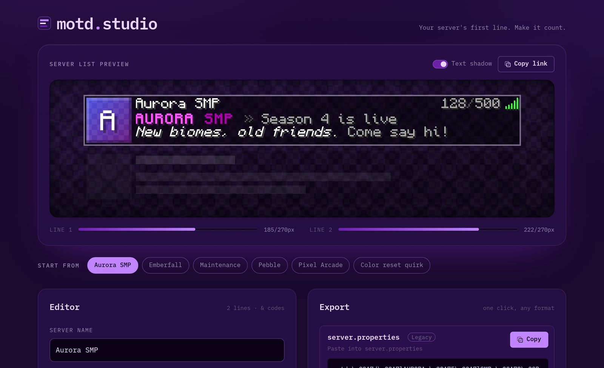

# motd-studio

A visual editor for Minecraft server MOTDs: write it once, see exactly how it looks in the server list, and export it in whatever format your server needs.




**Live demo:** https://armd.one/motd-studio/

## Features

- **Live server-list preview.** Server icon, name, both MOTD lines, player count and ping, drawn with the exact legacy color values and Minecraft-style 1px drop shadows (each channel at 25% brightness). You can switch the shadow off.
- **Width meters.** Each line shows how many GUI pixels it uses out of the visible 270, and text past the edge is clipped just like in game.
- **Obfuscated text (`&k`)** scrambles live. With `prefers-reduced-motion` turned on it holds still.
- **Editor with a toolbar.** A plain two-line `&`-code textarea is the source of truth. Select some text, then click a color, a format or the hex picker to wrap it. The style that was active before is restored after your selection. `Ctrl+B`, `Ctrl+I` and `Ctrl+U` work too, and so does undo.
- **One-click export** to five formats, each with its own copy button.
- **Import** from any supported format. Paste it and the format is detected for you.
- **Shareable links.** The MOTD lives in the URL hash, and your last session is restored from `localStorage`.
- **Six starter templates.** One of them is a live demo of the formatting quirk described below.
- **No dependencies.** Plain HTML, CSS and ES modules, with no build step.

### Export formats

| Format | Example | Hex colors |
| --- | --- | :---: |
| `server.properties` line | `motd=§6Hi\n§7there` | No, uses nearest legacy color |
| Raw `§` codes | `§6Hi` | No, uses nearest legacy color |
| `&` codes | `&6Hi` | No, uses nearest legacy color |
| JSON text component | `{"text":"Hi","color":"#C084FC"}` | **Yes** |
| MiniMessage | `<#c084fc>Hi` | **Yes** |

When your MOTD contains hex colors, each legacy export shows an inline warning listing which legacy color stood in for each hex value. "Nearest" is measured with a weighted RGB distance.

## The legacy formatting quirk

In Java Edition, **a color code resets all active formatting**. Bold, italic, underline, strikethrough and obfuscated are all cleared whenever a color code appears.

```
&l&6Gold    → gold, NOT bold   (the &6 wiped the &l)
&6&lGold    → gold and bold
&a&lHi &bthere → "Hi" is bold green, "there" is plain aqua
```

motd-studio models this rule in both directions. The parser clears formats on every color code, including hex colors. The serializer re-emits format codes after each color change, and when it needs to turn a format off it re-emits the color (or uses `&r`).

JSON and MiniMessage don't have this problem. Their styles nest, and a color change leaves other formatting alone.

## Formatting code reference

| Code | Color | Hex | | Code | Color | Hex |
| --- | --- | --- | --- | --- | --- | --- |
| `&0` | black | `#000000` | | `&8` | dark_gray | `#555555` |
| `&1` | dark_blue | `#0000AA` | | `&9` | blue | `#5555FF` |
| `&2` | dark_green | `#00AA00` | | `&a` | green | `#55FF55` |
| `&3` | dark_aqua | `#00AAAA` | | `&b` | aqua | `#55FFFF` |
| `&4` | dark_red | `#AA0000` | | `&c` | red | `#FF5555` |
| `&5` | dark_purple | `#AA00AA` | | `&d` | light_purple | `#FF55FF` |
| `&6` | gold | `#FFAA00` | | `&e` | yellow | `#FFFF55` |
| `&7` | gray | `#AAAAAA` | | `&f` | white | `#FFFFFF` |

| Code | Format | MiniMessage |
| --- | --- | --- |
| `&l` | bold | `<bold>` / `<b>` |
| `&o` | italic | `<italic>` / `<i>` |
| `&n` | underlined | `<underlined>` / `<u>` |
| `&m` | strikethrough | `<strikethrough>` / `<st>` |
| `&k` | obfuscated | `<obfuscated>` / `<obf>` |
| `&r` | reset | `<reset>` |
| `&#rrggbb` | hex color (editor only) | `<#rrggbb>` |

On import, the `§x§r§r§g§g§b§b` hex form used by Spigot/BungeeCord is also understood.

## Project layout

```
index.html
css/tokens.css      design tokens (palette, type, spacing; UI font swap point)
css/app.css         layout and components
js/mc-text.js       DOM-free parser/serializer for every format
js/editor.js        textarea + toolbar
js/preview.js       server-list rendering, width meters, obfuscation
js/export.js        export cards and copy buttons
js/state.js         URL hash, localStorage, templates
js/app.js           wiring
fonts/              Monocraft (woff2) + its license
test/               node --test suite for mc-text.js
```

The visible MOTD width is set by `MOTD_WIDTH` in `js/preview.js`. It is the only place to change it, and the row, clipping and meters all follow it. The preview font is monospaced while Minecraft's is proportional, so treat the meter as a close estimate rather than an exact count. Narrow letters like `i` and `l` take less room in game.

## Local development

ES modules don't load from `file://`, so serve the folder:

```sh
npx serve .
# or
python -m http.server
```

Then open http://localhost:3000 (serve) or http://localhost:8000 (python).

## Tests

Tests use Node's built-in runner (Node 18+), with nothing to install:

```sh
npm test
# same as: node --test
```

They cover round-trips between every pair of formats, the color-resets-formatting rule, hex handling and nearest-color fallback, and format detection.

## Deploy

The site is static and every path is relative, so it works from a project subpath.

1. Push to `main`.
2. In the repo, go to **Settings → Pages**.
3. Set **Source** to *Deploy from a branch*, choose `main` and `/ (root)`, then save.

## Credits

- Preview font: [Monocraft](https://github.com/IdreesInc/Monocraft) by Idrees Hassan, licensed under the [SIL Open Font License 1.1](fonts/Monocraft-OFL.txt). Bundled as woff2 conversions of the original release files.
- UI font: [IBM Plex Mono](https://github.com/IBM/plex) (SIL Open Font License 1.1), loaded from Google Fonts.

No Mojang textures, fonts or logos are used. The server-list backdrop, icon and ping bars are drawn with CSS.

motd-studio is not an official Minecraft product. It is not approved by or associated with Mojang or Microsoft.

## License

[MIT](LICENSE) © 2026 Aubergine-UX
